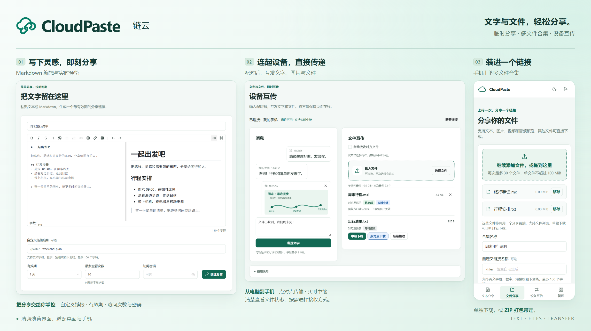
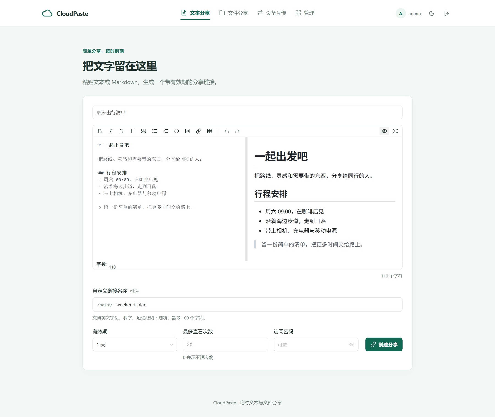
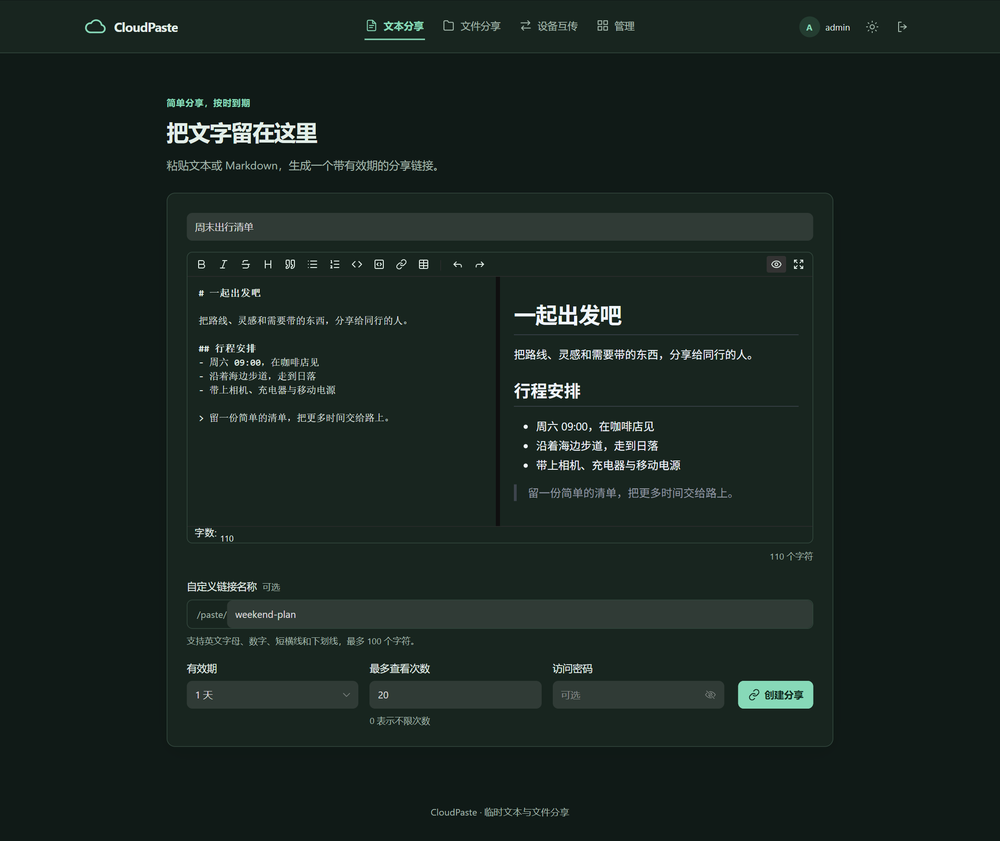
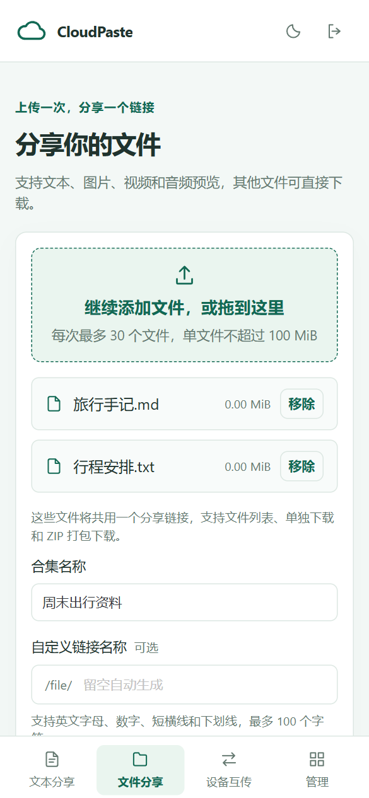
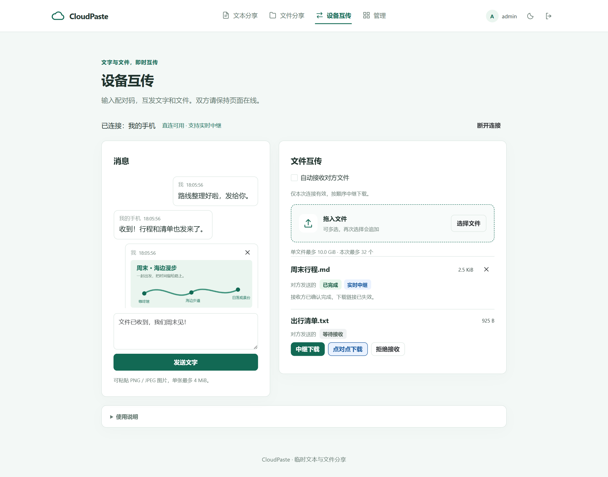
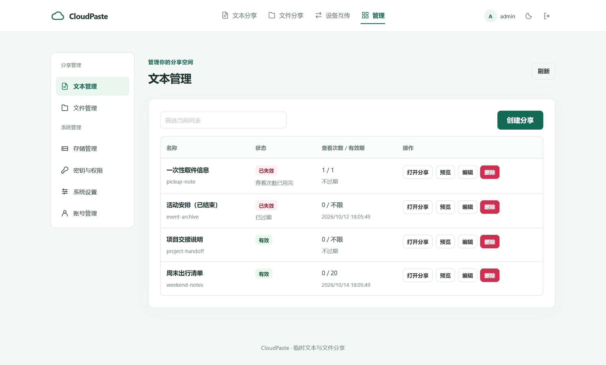
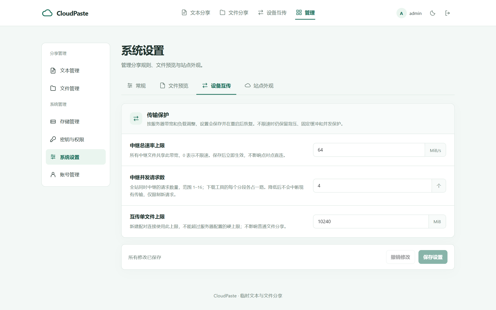

<div align="center">


# CloudPaste

**A small place for things you want to share.**

Self-hosted text and file sharing, with custom links, expiration, passwords and view limits.

[中文](../README.md) · [Documentation](README.md) · [API](api.md) · [Releases](https://github.com/Qwerto107/CloudPaste/releases)

**Go + Vue**　 / 　**LOCAL · S3**　 / 　**Docker · amd64 · arm64**

</div>

---

## A focused sharing experience



*A collage of current application screenshots showing Markdown editing, mobile file collections and device transfers.*

<details>
<summary><strong>View full screenshots: editing, uploads, transfers, management and settings</strong></summary>



<table>
  <tr><th width="70%">Dark mode</th><th width="30%">Mobile file collections</th></tr>
  <tr><td valign="top"></td><td valign="top"></td></tr>
</table>







*All screenshots use demonstration content.*

</details>

| Feature | What it offers |
| --- | --- |
| Text sharing | Plain text and Markdown, with editing and preview modes |
| File sharing | Drag and drop, batch uploads, individual link names and retrying remaining files |
| Link controls | Custom names, passwords, view limits and expiration from minutes to days |
| Previews | Text, images, browser-native video and audio; download other formats |
| Storage | Local directories and S3, connection tests, defaults and access controls |
| API Keys | Generated or custom values, separate sharing and management permissions |
| Administration | Share records, storage, keys, admin account and site settings |
| Device transfers | Pairing codes, text and pasted images, WebRTC file transfers and streaming relay downloads through the website port |

New shares expire after 24 hours by default. Expiring or deleting a share revokes access without deleting the stored file. Editing a filename changes its display name only.

Open `/transfer` to connect two devices. Relay downloads support the browser and external download tools such as AB Download Manager through the same link. Both pages must remain online; the server does not cache files. WebRTC downloads are available when the receiving browser supports saving directly to disk.

## Docker quick start

Run from the repository root with Docker Compose available:

```sh
cp backend/.env.example backend/.env
mkdir -p files
```

Edit `backend/.env` with your own strong password and matching image versions:

```dotenv
ADMIN_USERNAME=admin
ADMIN_PASSWORD=replace-with-your-own-strong-password
GO_BACKEND_IMAGE=ghcr.io/qwerto107/cloudpaste-backend:0.7.0
GO_FRONTEND_IMAGE=ghcr.io/qwerto107/cloudpaste-frontend:0.7.0
LOCAL_FILES_DIR=./files
```

On Linux, grant UID/GID `65532` access to the file directory. For a newly created dedicated directory, use `sudo chown 65532:65532 files`.

```sh
docker compose --env-file backend/.env pull
docker compose --env-file backend/.env up -d --no-build
```

Open `http://127.0.0.1:8081/admin/login`, sign in and configure LOCAL storage with `/files` as its root, or add S3 storage. Create API Keys for other users, who sign in at `/login`.

For a **single container with both the frontend and backend**, add `GO_STANDALONE_IMAGE=ghcr.io/qwerto107/cloudpaste-standalone:0.7.0` to `backend/.env` and run:

```sh
docker compose --env-file backend/.env -f docker-compose.standalone.yml pull
docker compose --env-file backend/.env -f docker-compose.standalone.yml up -d --no-build
```

The entry point remains `http://127.0.0.1:8081`. Both modes share the data volume; stop the original services before switching. See the [deployment guide](deployment.md) for public access, directory permissions, resource limits and upgrades. [Linux standalone binaries](binary.md) include the complete web interface in one executable; API-only binaries remain available.

## Local assets, clear boundaries

The Vue frontend builds into static pages. Scripts, styles and icons are served by the site; Markdown loads on demand. The backend streams uploads through private staging before writing to storage.

API Key management pages use `/manage/*`; administrator pages use `/admin/*`. Admin APIs use `/api/admin/*` and can be protected by an external reverse proxy with an IP allowlist or mTLS, in addition to account authentication.

Markdown blocks external images by default. Custom site HTML is sanitized. The mint interface supports light and dark modes, remembered theme choices and mobile navigation. The chain-cloud favicon adapts to the browser color scheme.

## Documentation

| Topic | Guide |
| --- | --- |
| Sharing, permissions and settings | [Usage](usage.md) |
| Docker, data and upgrades | [Deployment](deployment.md) |
| Single executable or API-only backend | [Binaries](binary.md) |
| Guest, API Key and administrator endpoints | [API reference](api.md) |
| Local development and checks | [Development](development.md) |
| Multi-platform images and release assets | [Publishing](releasing.md) |
| Version changes | [Changelog](changelog.md) |

Detailed guides are currently in Chinese.

---

Built with Go, SQLite and Vue · [Apache License 2.0](../LICENSE)
